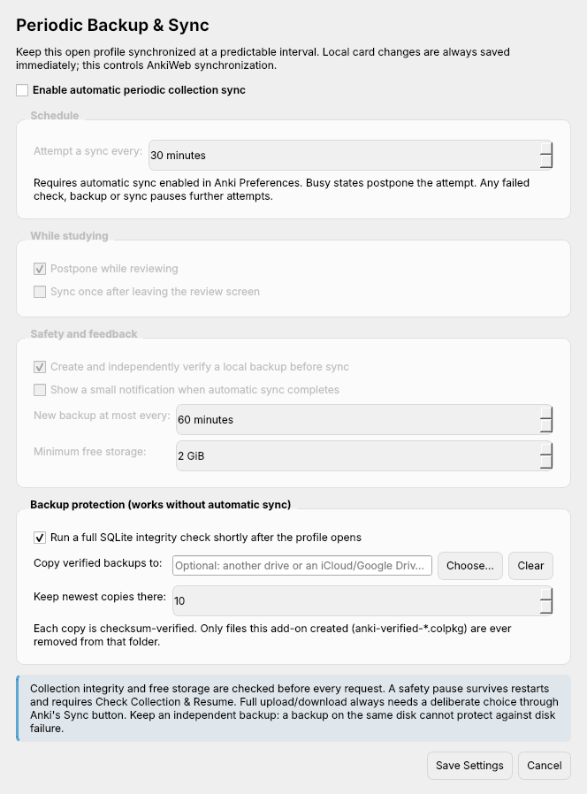

# Periodic Backup & Sync for Anki

Backup protection that works on its own, plus an optional, careful AnkiWeb sync while Anki stays open.



## Protection (no sync needed)

- **Startup integrity check** – about a minute after a profile opens, a read-only SQLite integrity check runs in
  the background. Damage found means a safety pause and one warning, so you learn about storage problems before
  every recent backup contains them.
- **Verified Backup Now (no sync)** – Anki makes a backup; the add-on opens the actual archive in a temporary
  folder, compares its complete contents with the open collection and runs an integrity check on it.
- **Backup mirror** (optional) – every verified backup is also copied to a folder you choose (another drive, an
  iCloud or Google Drive folder). Copies are flushed, re-hashed and published atomically; the newest *N* are
  kept. Only files named `anki-verified-<profile>-*.colpkg` are ever deleted there.

## Periodic sync (off by default)

- Needs this add-on's setting **and** Anki's own automatic-sync preference.
- Before every sync: integrity and free-space checks; an automatic backup at most once per
  `minimum_backup_interval_minutes` (default 60).
- Waits while you review (optional: sync once after leaving the review screen).
- Normal sync only. If AnkiWeb asks for a full sync, the add-on pauses and leaves the upload/download choice to
  you and Anki's Sync button.
- Any failed check, backup, sync or cancellation pauses further attempts – also across restarts.
  **Check Collection & Resume…** verifies the collection and a fresh backup before anything runs again.

## Menu

*Tools › Learning Toolkit › Backup & Sync*: Settings…, Sync Now, Verified Backup Now (no sync),
Backup + Sync Now, Status…, Check Collection & Resume…

It shares the *Learning Toolkit* menu with [anki-learning-toolkit](https://github.com/0Duc0/anki-learning-toolkit)
but is a separate add-on on purpose: it touches backups and sync, so it can be updated or switched off on its own.

## Install

Download `periodic_backup_sync-<version>.ankiaddon` from the [latest release](../../releases/latest),
double-click it and restart Anki. Requires Anki 25.02 or newer. Settings are described in
[`periodic_backup_sync/config.md`](periodic_backup_sync/config.md).

## Changes in 3.2.0

- The settings dialog scrolls on small screens instead of squeezing rows on top of each other.
- Neutral error messages in the shared backup verification code.
- Tests: backup verification against a real collection (matching, changed and broken archives), mirror copies
  and pruning, preflight checks, add-on loading, menu and settings dialog.

## Development

```
pip install anki aqt pytest
QT_QPA_PLATFORM=offscreen python -m pytest tests
python tools/package.py      # → dist/periodic_backup_sync-<version>.ankiaddon
```

## License

Personal project, no license granted.
